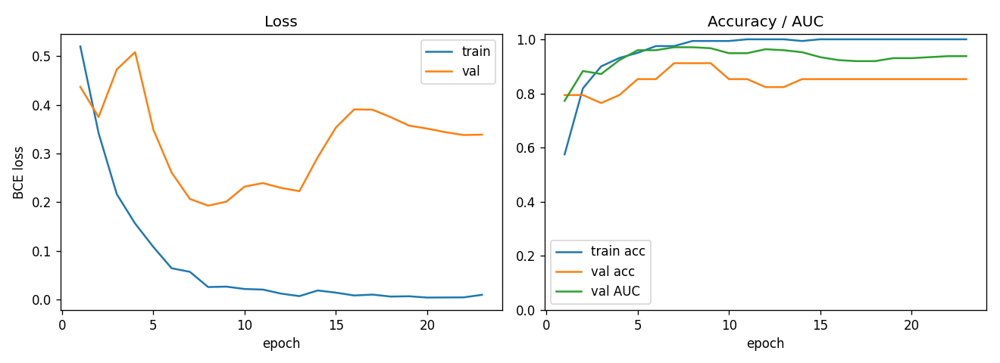
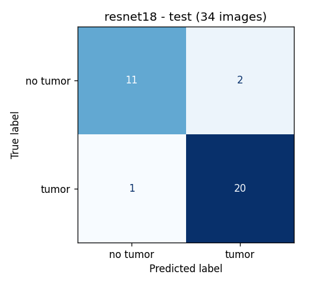
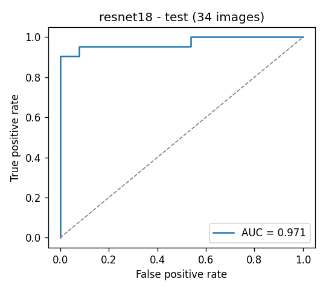
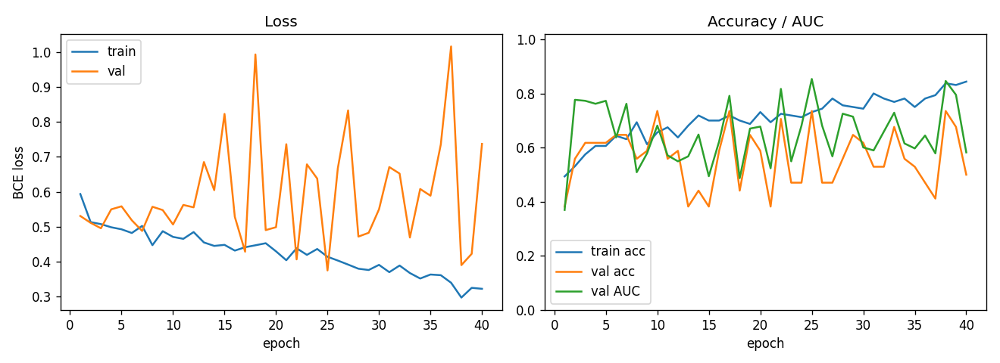
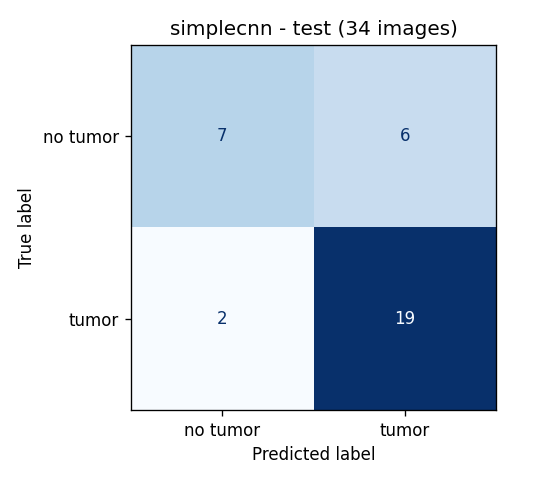
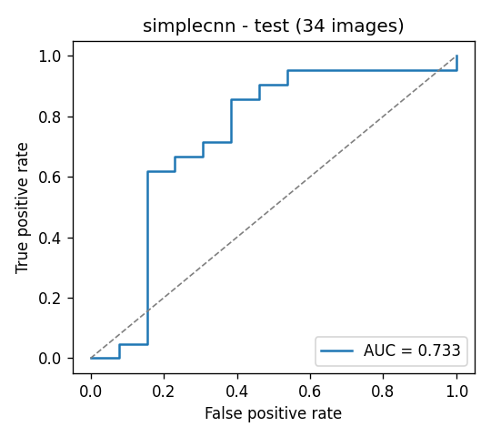

# MRI Segmentation and Classification using Deep Learning

Brain tumor detection on MRI slices: a CNN classifier (tumor / no tumor) trained on a Google Colab
A100 GPU, plus K-means tools for building segmentation masks.

Dataset: [Brain MRI Images for Brain Tumor Detection](https://www.kaggle.com/datasets/navoneel/brain-mri-images-for-brain-tumor-detection)
(Kaggle). A copy of it lives in `classification/` (`yes/` = tumor, `no/` = no tumor), identical to the Kaggle download.

## Repository layout

| Path | What it does |
|---|---|
| `dataset.py` | Downloads the dataset from Kaggle with `kagglehub` (optional, the repo already has it) |
| `preprocess.py` | Deduplication, brain crop, resize and stratified, group-aware train/val/test split |
| `classifier.py` | Models (ResNet-18 and a small CNN), transforms and data loading |
| `train.py` | Training with early stopping on the validation loss |
| `evaluate.py` | Test metrics with 95% bootstrap intervals, confusion matrix, ROC curve, per-image predictions |
| `colab/run_colab.sh` | Runs preprocess, train and evaluate on a Colab A100 and downloads `results/` |
| `colab/remote_train.py` | The part of the pipeline that runs inside the Colab kernel |
| `results/` | Outputs of the experiment reported below |
| `kmeans.py`, `eraser.py`, `segmentation/` | K-means segmentation, manual mask cleanup and the 3 masks made so far |

## Pipeline

### 1. Data and preprocessing (`preprocess.py`)

The Kaggle dataset has 253 images (155 tumor, 98 no tumor) of many sizes (184 different shapes) and
color modes (RGB, grayscale, RGBA, palette). It also has **repeated images**: 25 files are
byte-identical copies of other files, and a few more are near-identical. A plain random split would put
copies of the same scan in train and test and inflate the test score, so the preprocessing:

1. converts every image to grayscale;
2. drops the 25 byte-identical copies (253 → 228 images);
3. groups near-duplicates by an 8x8 difference hash (228 images → 216 groups), so a group never spans two splits;
4. crops each image to the head (largest bright contour), pads it to a square and resizes it to 224x224;
5. splits whole groups per class into train/val/test (70/15/15, seed 42).

| Split | No tumor | Tumor | Total |
|---|---:|---:|---:|
| train | 61 | 99 | 160 |
| val | 13 | 21 | 34 |
| test | 13 | 21 | 34 |

The split used in the experiment is in `results/splits.csv` (with the source file of every image) and
`results/summary.json` (counts and the list of dropped copies).

### 2. Models (`classifier.py`)

- **ResNet-18** pretrained on ImageNet, with a dropout + single-logit head (11.2 M parameters). Main model.
- **SimpleCNN**: 4 blocks of two 3x3 conv + batch norm + ReLU and max pooling (32 → 256 channels),
  global average pooling and a single-logit head, trained from scratch (1.2 M parameters). Baseline.

### 3. Training (`train.py`)

- Augmentation: random resized crop (scale 0.85-1), horizontal flip, rotation up to 15°, brightness/contrast jitter.
- Loss: `BCEWithLogitsLoss` with `pos_weight = n_no / n_yes` to balance the classes.
- AdamW (lr 1e-4 for ResNet-18, 1e-3 for SimpleCNN, weight decay 1e-4), cosine schedule, batch 32,
  bf16 autocast on GPU, up to 60 epochs.
- The checkpoint with the lowest validation loss is kept; training stops after 15 epochs without improvement.
- The test set is used only once, by `evaluate.py`, after training.

### 4. Evaluation (`evaluate.py`)

Accuracy, precision, recall (sensitivity), specificity, F1 and ROC AUC on the test set, with a threshold
of 0.5 and 95% confidence intervals from 2,000 bootstrap resamples of the test images. It also saves the
confusion matrix, the ROC curve and the per-image probabilities (`predictions.csv`).

## Running

### On Google Colab (how the results below were produced)

Requires the [Colab CLI](https://pypi.org/project/google-colab-cli/) (`uv tool install google-colab-cli`)
logged in to an account with GPU access (`colab usage` shows the compute unit balance).

```bash
colab/run_colab.sh                 # resnet18 and simplecnn
colab/run_colab.sh resnet18        # only one model
COLAB_GPU=L4 EPOCHS=30 colab/run_colab.sh
```

The script packs the code and `classification/`, creates an A100 session (`--high-mem`, the 80 GB shape),
runs the whole pipeline, downloads `results/` and stops the session, even if a step fails.
The log, including the compute units before and after, goes to `results/colab_run.log`.

### Locally

```bash
pip install -r requirements.txt
python preprocess.py --data_dir classification --output_dir data/processed
python train.py --arch resnet18
python evaluate.py --checkpoint results/resnet18/model.pt
```

To start from the Kaggle download instead of the copy in the repo:
`python preprocess.py --data_dir "$(python dataset.py | tail -1)"`.

## Results

Run on 2026-10-26 on a Colab **NVIDIA A100-SXM4-80GB** (torch 2.11.0, CUDA 13.0), seed 42.
The whole Colab session (setup, both models, download) took 140 s; training took 13 s (ResNet-18) and 19 s (SimpleCNN).

Test set: 34 images (21 tumor, 13 no tumor), never seen during training or model selection.

| Metric | ResNet-18 (pretrained) | SimpleCNN (from scratch) |
|---|---|---|
| Accuracy | **0.912** (0.794-1.000) | 0.765 (0.618-0.912) |
| Precision | **0.909** (0.762-1.000) | 0.760 (0.577-0.920) |
| Recall / sensitivity | **0.952** (0.842-1.000) | 0.905 (0.762-1.000) |
| Specificity | **0.846** (0.625-1.000) | 0.538 (0.250-0.800) |
| F1 | **0.930** (0.837-1.000) | 0.826 (0.683-0.931) |
| ROC AUC | **0.971** (0.902-1.000) | 0.733 (0.506-0.920) |
| Confusion (TN / FP / FN / TP) | 11 / 2 / 1 / 20 | 7 / 6 / 2 / 19 |
| Best epoch / epochs run | 8 / 23 | 25 / 40 |

Values in parentheses are 95% bootstrap confidence intervals.

### ResNet-18

| Training curves | Confusion matrix | ROC curve |
|---|---|---|
|  |  |  |

### SimpleCNN

| Training curves | Confusion matrix | ROC curve |
|---|---|---|
|  |  |  |

### Discussion

- Transfer learning makes the difference on such a small dataset: the pretrained ResNet-18 misses 3 of the
  34 test images (2 false positives, 1 false negative), while the CNN trained from scratch misses 8 and
  flags almost half of the healthy scans as tumor (specificity 0.54).
- The ResNet-18 reaches its best validation loss at epoch 8 and then overfits (train loss near zero,
  validation loss rising), which is why early stopping on the validation loss matters here.
- With only 34 test images the intervals are wide (accuracy 0.79-1.00 for ResNet-18). The numbers
  show the pipeline works, not a clinical-grade estimate; cross-validation or a larger dataset would be
  needed for that.
- The two runs made on Colab (A100 40 GB and A100 80 GB) gave identical metrics with seed 42.

## Segmentation tools

- `kmeans.py`: segments one image by K-means over the pixel colors and saves one binary mask per
  cluster (`python kmeans.py --input images/input/image.jpg --clusters 4 --output_dir images/output`).
- `eraser.py`: interactive OpenCV brush to erase the wrong regions of a mask (`python eraser.py --image mask.png`).
- `segmentation/image` and `segmentation/mask`: the 3 image/mask pairs made with these tools. They are
  not enough to train a segmentation model yet.
