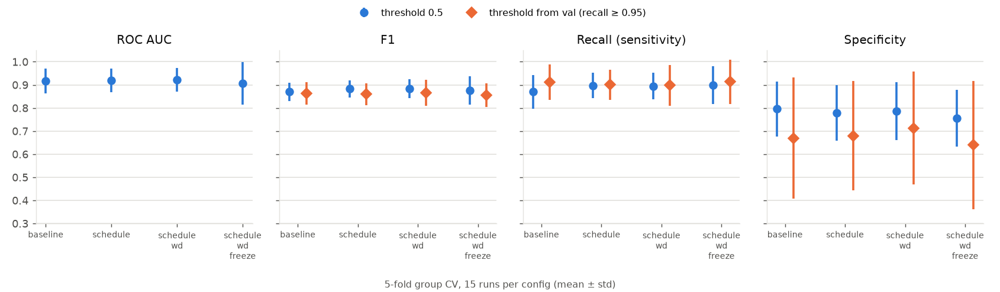
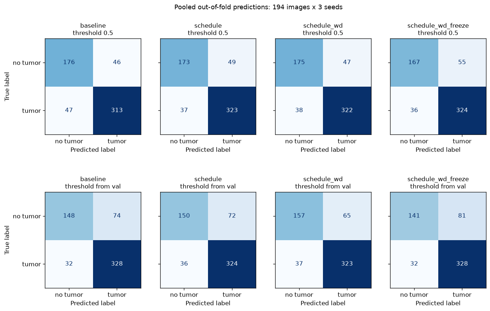
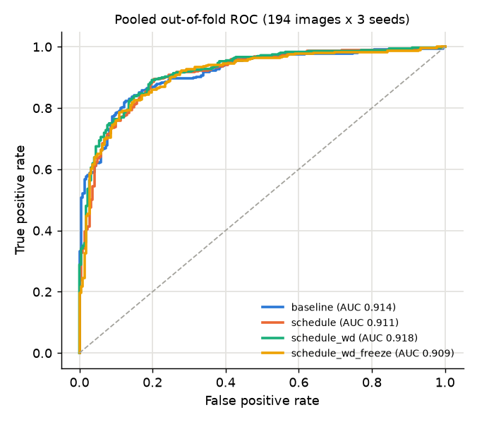
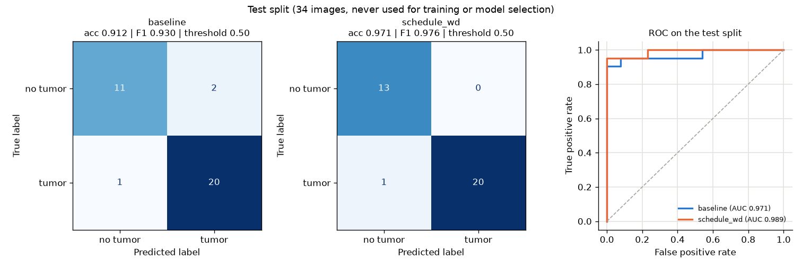
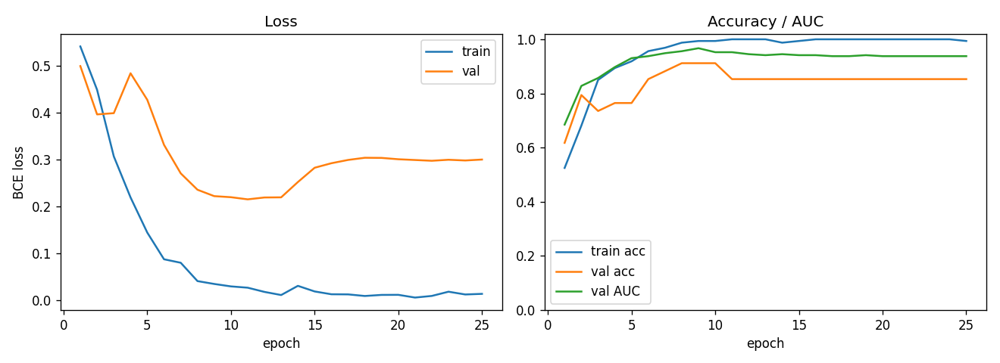

# MRI Segmentation and Classification using Deep Learning

Brain tumor detection on MRI slices: a CNN classifier (tumor / no tumor) trained on a Google Colab
A100 GPU, compared across training configurations with group-aware cross-validation, plus K-means
tools for building segmentation masks.

Dataset: [Brain MRI Images for Brain Tumor Detection](https://www.kaggle.com/datasets/navoneel/brain-mri-images-for-brain-tumor-detection)
(Kaggle). A copy of it lives in `classification/` (`yes/` = tumor, `no/` = no tumor), identical to the Kaggle download.

## Results at a glance

- **Cross-validation (main result).** An ImageNet-pretrained ResNet-18 reaches a mean ROC AUC of
  **0.92 ± 0.05** and accuracy of **0.85 ± 0.05** over 5 group-aware folds × 3 seeds. No training
  configuration shows a consistent AUC gain over the baseline; the best one (`schedule_wd`, cosine
  schedule sized to the run + weight decay 5e-2) is +0.005 AUC, 95% CI [−0.028, 0.039] (corrected
  repeated k-fold t-test).
- **Pretraining control.** The same ResNet-18 and training setup from random initialization
  (`baseline_scratch`) drops to a mean AUC of **0.74 ± 0.08**: −0.173, 95% CI [−0.299, −0.047], and
  the pretrained model wins all 15 runs. On the test split it misses 9 images against 3
  (exact McNemar p = 0.031).
- **Test split (confirmation).** On the 34 held-out images, `schedule_wd` misses 1 image
  (accuracy 0.971, F1 0.976, AUC 0.989) against 3 for the baseline (0.912 / 0.930 / 0.971).
  The two models disagree on 2 images (exact McNemar p = 0.5), so the cross-validation is the
  number to trust.
- Picking the decision threshold on the validation split (recall ≥ 0.95) did not help: it buys a
  little recall at the cost of a large, unstable drop in specificity. The fixed 0.5 threshold is kept.



## Repository layout

| Path | What it does |
|---|---|
| `dataset.py` | Downloads the dataset from Kaggle with `kagglehub` (optional, the repo already has it) |
| `preprocess.py` | Deduplication, brain crop, resize and stratified, group-aware train/val/test split |
| `classifier.py` | Models (ResNet-18 and a small CNN), transforms, data loading, threshold selection |
| `configs.py` | The training configurations compared by the cross-validation |
| `train.py` | Training (warmup + cosine, optional head-only epochs, early stopping, checkpoint per epoch) |
| `cv.py` | Group-aware 5-fold cross-validation of the configs and its summary, tables and figures |
| `evaluate.py` | Test metrics with 95% bootstrap intervals, confusion matrix, ROC curve, per-image predictions |
| `compare.py` | Side-by-side test figure of several evaluated runs |
| `colab/run_colab.sh` | Runs the pipeline on a Colab A100, downloads `results/` and the checkpoints |
| `colab/remote_train.py` | The part of the pipeline that runs inside the Colab kernel |
| `results/` | Outputs of the experiments reported below (checkpoints are not versioned) |
| `paper/` | IEEE paper (Portuguese) and `analysis.py`, which computes its statistics and test figure from `results/` |
| `kmeans.py`, `eraser.py`, `segmentation/` | K-means segmentation, manual mask cleanup and the 3 masks made so far |

## Pipeline

### 1. Data and preprocessing (`preprocess.py`)

The Kaggle dataset has 253 images (155 tumor, 98 no tumor) of many sizes (184 different shapes) and
color modes (RGB, grayscale, RGBA, palette). It also has **repeated images**: 25 files are
byte-identical copies of other files, and a few more are near-identical. A plain random split would put
copies of the same scan in train and test and inflate the test score, so the preprocessing:

1. converts every image to grayscale;
2. drops the 25 byte-identical copies (253 → 228 images);
3. groups near-duplicates by an 8x8 difference hash (228 images → 216 groups), so a group never spans two splits;
4. crops each image to the head (largest bright contour), pads it to a square and resizes it to 224x224;
5. splits whole groups per class into train/val/test (70/15/15, seed 42).

| Split | No tumor | Tumor | Total |
|---|---:|---:|---:|
| train | 61 | 99 | 160 |
| val | 13 | 21 | 34 |
| test | 13 | 21 | 34 |

The split is in `results/splits.csv` (with the source file and group of every image) and
`results/summary.json` (counts and the list of dropped copies).

### 2. Models (`classifier.py`)

- **ResNet-18** pretrained on ImageNet, with a dropout + single-logit head (11.2 M parameters). Main model.
- **SimpleCNN**: 4 blocks of two 3x3 conv + batch norm + ReLU and max pooling (32 → 256 channels),
  global average pooling and a single-logit head, trained from scratch (1.2 M parameters). Baseline of
  the first experiment.

### 3. Training and the compared configurations (`train.py`, `configs.py`)

Common to every configuration: augmentation (random resized crop 0.85-1, horizontal flip, rotation up
to 15°, brightness/contrast jitter), `BCEWithLogitsLoss` with `pos_weight = n_no / n_yes`, AdamW,
batch 32, learning rate 1e-4, bf16 autocast on GPU, and the checkpoint with the lowest validation loss
is kept (early stopping after 15 epochs without improvement).

Each configuration changes the previous one; `schedule` changes both the cosine length and the
warmup, and `schedule_wd_freeze` both the frozen epochs and the head learning rate, so those steps do
not isolate a single factor. `baseline_scratch` is a control outside the chain: `baseline` with random
initialization instead of the ImageNet weights.

| Config | Epochs (cosine length) | Warmup | Weight decay | Head-only epochs | Head LR |
|---|---:|---:|---:|---:|---:|
| `baseline` (first experiment) | 60 | 0 | 1e-4 | 0 | 1e-4 |
| `schedule` | 25 | 2 | 1e-4 | 0 | 1e-4 |
| `schedule_wd` | 25 | 2 | 5e-2 | 0 | 1e-4 |
| `schedule_wd_freeze` | 25 | 2 | 5e-2 | 3 | 1e-3 |
| `baseline_scratch` (control, random init) | 60 | 0 | 1e-4 | 0 | 1e-4 |

Why: in the first experiment the cosine was sized for 60 epochs but early stopping ended the run at
epoch 23, so the learning rate was still at 96% of its initial value at the best epoch; 1e-4 is a weak
weight decay for AdamW; and training the whole network from the first step lets the random head push
noisy gradients into the pretrained features.

### 4. Cross-validation (`cv.py`)

Only the 194 train + val images are used; the test split stays untouched until the end.

- For each seed (42, 43, 44) the images are split into 5 folds with `StratifiedGroupKFold`, so
  near-duplicate groups never cross folds and every fold keeps the class balance.
- In each fold the model trains on 4 folds, with an inner group-aware validation split (15%) for
  early stopping and for picking the decision threshold, and is evaluated on the 5th fold.
- Every configuration sees the same seeds and folds, so differences are compared run by run.
- Each fold is evaluated with the fixed 0.5 threshold and with the threshold chosen on the inner
  validation split: the highest one that keeps recall ≥ 0.95 there.
- The rule to pick the best configuration was fixed before the runs: **highest mean ROC AUC**.

That is 15 runs per configuration and 60 in total. Every image gets one out-of-fold prediction per
seed (`results/cv/<config>/oof.csv`), which feeds the pooled confusion matrices and ROC curves below.

### 5. Final model and test (`train.py`, `evaluate.py`, `compare.py`)

The best configuration and the baseline are retrained on the original train/val split and evaluated
**once** on the 34 test images, with both thresholds. The best configuration saves a checkpoint per epoch.

### 6. Evaluation metrics (`evaluate.py`)

Accuracy, precision, recall (sensitivity), specificity, F1 and ROC AUC, with 95% confidence intervals
from 2,000 bootstrap resamples of the test images, plus the confusion matrix, the ROC curve and the
per-image probabilities (`predictions.csv`).

## Running

### On Google Colab (how the results below were produced)

Requires the [Colab CLI](https://pypi.org/project/google-colab-cli/) (`uv tool install google-colab-cli`)
logged in to an account with GPU access (`colab usage` shows the compute unit balance).

```bash
# cross-validate configs.py, retrain baseline + best config, evaluate on test, download checkpoints
PIPELINE=cv CKPT_DIR=~/models/MRI-segmentation/run1 colab/run_colab.sh

# only the cross-validation
PIPELINE=cv CV_ONLY=1 colab/run_colab.sh

# pretraining control: cross-validate, retrain and evaluate baseline_scratch (results/cv_scratch)
PIPELINE=scratch CKPT_DIR=~/models/MRI-segmentation/scratch colab/run_colab.sh

# first experiment: train + evaluate ResNet-18 and SimpleCNN
colab/run_colab.sh
```

The script packs the code and `classification/`, creates an A100 session (`--high-mem`, the 80 GB shape),
runs the pipeline, downloads `results/` and the checkpoints and stops the session, even if a step fails.
The configurations run in parallel on the same GPU. The log, including the compute units before and
after, goes to `results/cv/colab_run.log` (cv) or `results/colab_run.log` (train).

### Locally

```bash
pip install -r requirements.txt
python preprocess.py --data_dir classification --output_dir data/processed
python cv.py --config schedule_wd                     # one configuration, 15 runs
python cv.py --summarize results/cv                   # tables and figures of every config run so far
python train.py --config schedule_wd --save_every_epoch --output_dir results/final/schedule_wd
python evaluate.py --checkpoint results/final/schedule_wd/model.pt
python evaluate.py --checkpoint results/final/schedule_wd/model.pt --threshold val --suffix _valthr
python compare.py results/final/baseline results/final/schedule_wd
```

To start from the Kaggle download instead of the copy in the repo:
`python preprocess.py --data_dir "$(python dataset.py | tail -1)"`.

## Results

All runs on 2026-10-26 on a Colab **NVIDIA A100-SXM4-80GB** (torch 2.11.0, CUDA 13.0).

### Cross-validation (main result)

5 group-aware folds × 3 seeds = 15 runs per configuration, mean ± standard deviation. Threshold 0.5:

| Config | ROC AUC | Accuracy | F1 | Recall | Specificity | ΔAUC vs baseline (wins / ties / losses) |
|---|---|---|---|---|---|---|
| baseline | 0.917 ± 0.054 | 0.840 ± 0.045 | 0.870 ± 0.039 | 0.870 ± 0.073 | 0.796 ± 0.118 | - |
| schedule | 0.919 ± 0.051 | 0.852 ± 0.048 | 0.882 ± 0.037 | 0.897 ± 0.054 | 0.779 ± 0.120 | +0.002 (8 / 1 / 6) |
| **schedule_wd** | **0.923 ± 0.051** | 0.853 ± 0.051 | 0.883 ± 0.040 | 0.895 ± 0.058 | 0.787 ± 0.126 | +0.005 (9 / 1 / 5) |
| schedule_wd_freeze | 0.906 ± 0.091 | 0.844 ± 0.070 | 0.876 ± 0.061 | 0.899 ± 0.082 | 0.756 ± 0.122 | −0.011 (8 / 0 / 7) |

Threshold chosen on the inner validation split (recall ≥ 0.95):

| Config | Accuracy | F1 | Recall | Specificity |
|---|---|---|---|---|
| baseline | 0.818 ± 0.079 | 0.863 ± 0.050 | 0.912 ± 0.077 | 0.670 ± 0.262 |
| schedule | 0.814 ± 0.075 | 0.859 ± 0.047 | 0.901 ± 0.065 | 0.680 ± 0.238 |
| schedule_wd | 0.825 ± 0.083 | 0.865 ± 0.056 | 0.899 ± 0.089 | 0.712 ± 0.244 |
| schedule_wd_freeze | 0.806 ± 0.084 | 0.856 ± 0.051 | 0.913 ± 0.096 | 0.639 ± 0.277 |

The full table is in `results/cv/summary.md`, every run in `results/cv/<config>/folds.csv`.
The cross-validation was run twice on Colab (the second time to save the out-of-fold predictions) and
gave identical numbers in every cell. Each run takes ~14-17 s; the 60 runs take ~7 min with the four
configurations in parallel on one A100.

**Pooled out-of-fold confusion matrices** (every image predicted once per seed by a model that never saw it):



**Pooled out-of-fold ROC curves:**



The pooled AUCs (0.909-0.918) sit slightly below the per-fold means of the table because pooling mixes
the scores of 15 different models, whose probabilities are not calibrated on the same scale. The ranking
is the same: `schedule_wd` first, `schedule_wd_freeze` last, all within 0.01.

### Test split (confirmation)

34 images (21 tumor, 13 no tumor), never used for training, model selection or threshold choice.

| | baseline | schedule_wd |
|---|---|---|
| Accuracy | 0.912 (0.794-1.000) | **0.971** (0.912-1.000) |
| Precision | 0.909 (0.762-1.000) | **1.000** (1.000-1.000) |
| Recall | 0.952 (0.842-1.000) | 0.952 (0.842-1.000) |
| Specificity | 0.846 (0.625-1.000) | **1.000** (1.000-1.000) |
| F1 | 0.930 (0.837-1.000) | **0.976** (0.914-1.000) |
| ROC AUC | 0.971 (0.902-1.000) | **0.989** (0.953-1.000) |
| TN / FP / FN / TP | 11 / 2 / 1 / 20 | 13 / 0 / 1 / 20 |
| Best epoch / epochs run | 8 / 23 | 11 / 25 |
| Threshold chosen on val (recall ≥ 0.95) | 0.646 | 0.422 |

95% bootstrap intervals in parentheses. With the validation-chosen thresholds every test prediction
stays the same (same confusion matrices), so the table holds for both thresholds.



| Training curves: baseline | Training curves: schedule_wd |
|---|---|
|  |  |

Per-run figures: `results/final/<config>/confusion_matrix*.png` and `roc_curve*.png`
(`_valthr` = threshold chosen on validation).

### Discussion

- **The training changes are within noise.** Sizing the cosine to the run and raising the weight
  decay move the mean AUC by +0.002 and +0.005, with a paired standard deviation of ~0.03 and a near
  even split of wins and losses. They are sensible defaults, but they do not change the model much.
- **Freezing the backbone hurt slightly** (−0.011 AUC) and almost doubled the spread across folds:
  with 3 head-only epochs out of 25 there is less time left to adapt the whole network.
- **The validation-chosen threshold is unstable.** With ~23 images in each inner validation split the
  threshold jumps from fold to fold; it lifts recall a little (0.87 → 0.91 on the baseline) and costs
  specificity a lot (0.80 → 0.67, ±0.26). A threshold policy would need a larger validation set.
- **The test gain of `schedule_wd` is mostly luck of the draw.** It gets right the 2 healthy scans the
  baseline flagged as tumor, and both miss the same tumor. The cross-validation, which averages
  15 evaluations of ~39 images, puts any of the first three configurations around 0.92 AUC and
  0.85 accuracy, below the 0.97 seen on the 34 test images.
- Retraining the baseline reproduces the first experiment exactly (best epoch 8, same metrics).

### First experiment: ResNet-18 vs SimpleCNN

Single train/val/test split, `baseline` training configuration, test split (34 images):

| Metric | ResNet-18 (pretrained) | SimpleCNN (from scratch) |
|---|---|---|
| Accuracy | **0.912** (0.794-1.000) | 0.765 (0.618-0.912) |
| Precision | **0.909** (0.762-1.000) | 0.760 (0.577-0.920) |
| Recall / sensitivity | **0.952** (0.842-1.000) | 0.905 (0.762-1.000) |
| Specificity | **0.846** (0.625-1.000) | 0.538 (0.250-0.800) |
| F1 | **0.930** (0.837-1.000) | 0.826 (0.683-0.931) |
| ROC AUC | **0.971** (0.902-1.000) | 0.733 (0.506-0.920) |
| Confusion (TN / FP / FN / TP) | 11 / 2 / 1 / 20 | 7 / 6 / 2 / 19 |

| | Training curves | Confusion matrix | ROC curve |
|---|---|---|---|
| ResNet-18 |  |  |  |
| SimpleCNN |  |  |  |

The CNN trained from scratch flags almost half of the healthy scans as tumor (specificity 0.54). It
differs from the ResNet-18 in architecture and learning rate too, so the control below isolates the
effect of pretraining.

### Pretraining control: ResNet-18 from random initialization

`baseline_scratch` is `baseline` with random weights: same architecture, hyperparameters, seeds and
folds (run on 2026-10-26, same Colab A100, 0.35 compute units). Cross-validation (15 runs, threshold 0.5):

| Config | ROC AUC | Sensitivity | Specificity | ΔAUC vs baseline [corrected 95% CI] (wins / ties / losses) |
|---|---|---|---|---|
| baseline (ImageNet) | 0.917 ± 0.054 | 0.870 ± 0.073 | 0.796 ± 0.118 | - |
| baseline_scratch (random) | 0.744 ± 0.082 | 0.702 ± 0.101 | 0.633 ± 0.162 | −0.173 [−0.299, −0.047] (0 / 0 / 15) |

Test split (34 images), 95% Wilson intervals for proportions and bootstrap interval for the AUC:

| Metric | baseline (ImageNet) | baseline_scratch (random) |
|---|---|---|
| Accuracy | 0.912 (0.77-0.97) | 0.735 (0.57-0.85) |
| Sensitivity | 0.952 (0.77-0.99) | 0.857 (0.65-0.95) |
| Specificity | 0.846 (0.58-0.96) | 0.538 (0.29-0.77) |
| ROC AUC | 0.971 (0.90-1.00) | 0.766 (0.56-0.94) |
| TN / FP / FN / TP | 11 / 2 / 1 / 20 | 7 / 6 / 3 / 18 |

The two models disagree on 6 test images, all right for the pretrained one (exact McNemar p = 0.031);
`baseline_scratch` and SimpleCNN are indistinguishable (p = 1.0). The control reuses hyperparameters
chosen for fine-tuning, and in 4 of the 15 folds its best epoch was past 40, so a search of its own could
narrow the gap. `python paper/analysis.py` recomputes every interval and test above from `results/`.

## Checkpoints

`train.py` always keeps the best checkpoint (`model.pt`, lowest validation loss) and, with
`--save_every_epoch`, one checkpoint per epoch in `checkpoints/epoch_XXX.pt`. Each file holds the
weights, the epoch, its validation metrics and the full configuration, and `evaluate.py` takes any of
them. They are not versioned (~45 MB each); `colab/run_colab.sh` unpacks them under `$CKPT_DIR`.
The final `schedule_wd` run produced 25 epoch checkpoints + `model.pt` (best epoch 11), and the
baseline its `model.pt`, 1.2 GB in total.

```bash
python evaluate.py --checkpoint <CKPT_DIR>/results/final/schedule_wd/checkpoints/epoch_011.pt \
    --output_dir results/epoch_011
```

## Segmentation tools

- `kmeans.py`: segments one image by K-means over the pixel colors and saves one binary mask per
  cluster (`python kmeans.py --input images/input/image.jpg --clusters 4 --output_dir images/output`).
- `eraser.py`: interactive OpenCV brush to erase the wrong regions of a mask (`python eraser.py --image mask.png`).
- `segmentation/image` and `segmentation/mask`: the 3 image/mask pairs made with these tools. They are
  not enough to train a segmentation model yet.
